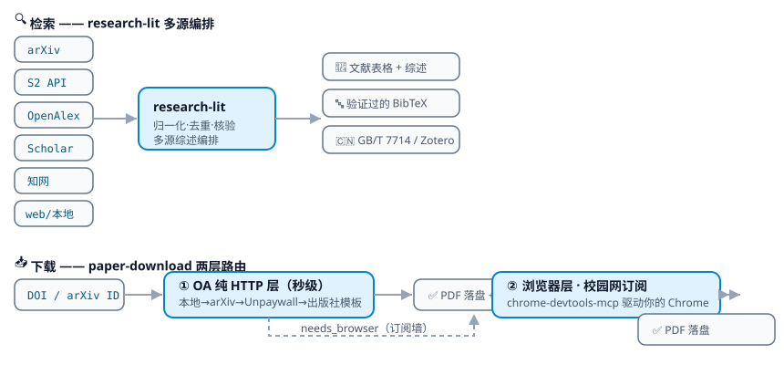

<p align="center">
  
</p>

<p align="center">
  <strong>给 AI 编程助手用的文献工具包：查文献、下论文、导出参考文献</strong>
</p>

<p align="center">
  <a href="https://github.com/wyl010607/papersearch-skill/releases"></a>
  <a href="https://github.com/wyl010607/papersearch-skill/actions"></a>
  <a href="LICENSE"></a>
  
  
  <a href="https://github.com/wyl010607/papersearch-skill/stargazers"></a>
</p>

<p align="center">
  <a href="README.md">中文</a> · <a href="README.en.md">English</a> ·
  <a href="https://github.com/wyl010607/papersearch-skill/releases">下载</a> ·
  <a href="https://github.com/wyl010607/papersearch-skill/issues">反馈</a>
</p>

---

## 它能做什么

装进你的 AI 编程助手（Claude Code、Codex、WorkBuddy、Qoder、Qwen Code、DeepSeek Harness、ZCode 都支持），然后它就能帮你做三件事：

1. **查文献**：一次搜 arXiv、Semantic Scholar、OpenAlex、谷歌学术、知网（含专利，实验性）多个来源，汇总成一张表，去重后给出综述。中文文献走知网，英文走其余来源。
2. **下论文**：公开可下的论文直接下载到项目的 `papers/` 目录；需要订阅的（IEEE、Elsevier、Nature、ACM、Springer、Wiley），会打开你自己的 Chrome，用校园网或机构订阅的权限去下。
3. **导出参考文献**：GB/T 7714、BibTeX 格式，也可以直接推送到 Zotero。

不用装任何 Python 包，不用申请任何 API key。

## 给 Agent 的一句话（复制粘贴即用）

```text
请安装 papersearch-skill 并按其 README「安装后」一节完成配置：
curl -fsSL https://raw.githubusercontent.com/wyl010607/papersearch-skill/main/install.sh | bash -s -- --all
```

## 安装

一行命令（自动下载仓库并装入指定工具；装了多个工具的机器会让你用 `--to` 明确指定）：

```bash
curl -fsSL https://raw.githubusercontent.com/wyl010607/papersearch-skill/main/install.sh | bash -s -- --to claude
```

其他方式：

```bash
npx skills add wyl010607/papersearch-skill   # npm 方式，自动识别 50+ 种 agent
./install.sh --to workbuddy                  # 从 Release zip 或 git 检出后运行
./install.sh --list                          # 列出全部可装的 skill
```

| 工具 | 安装位置 | 工具 | 安装位置 |
|------|---------|------|---------|
| Claude Code | `~/.claude/skills/` | WorkBuddy | `~/.workbuddy/skills/`（也支持界面导入 zip） |
| Codex CLI | `~/.codex/skills/` | Qoder | `~/.qoder/skills/` |
| ZCode | `~/.zcode/skills/` | Qwen Code | `~/.qwen/skills/` |
| DeepSeek Harness | 项目 `./skills/` | 通用/其他 | `~/.agents/skills/` |

## 实际效果

知网检索、下载、导出引用（浏览器操作你自己的 Chrome）：

```text
$ /cnki 扩散模型 时间序列预测
✓ 检索完成 → 44 条结果（页 1/3）
✓ 解析本页 20 条（标题/作者/期刊/被引/下载量）
✓ 下载 → papers/面向多分辨率时序预测的协变量条件扩散模型_吉训生.pdf
          (1.0 MB · PDF 校验通过)
✓ 导出 GB/T 7714 引用：
  吉训生,付凯旋.面向多分辨率时序预测的协变量条件扩散模型[J/OL].
  计算机工程,1-12[2026-10-29].https://doi.org/10.19678/j.issn.1000-3428.0252999.
```

按 DOI 下载英文论文（不用开浏览器）：

```bash
$ python3 paper_download.py download 10.3389/fnins.2011.00008 --dir papers
{
  "status": "downloaded",
  "route": "https://www.frontiersin.org/journals/neuroscience/articles/10.3389/fnns.2011.00008/pdf",
  "path": "papers/10.3389_fnins.2011.00008.pdf",
  "size_kb": 1880
}
```

## 包含哪些 skill

| Skill | 用途 | 需要什么 |
|-------|------|---------|
| `research-lit` | 给定课题，多来源检索并写文献综述 | 无 |
| `arxiv` | 搜 arXiv、看详情、下载 PDF | 无 |
| `semantic-scholar` | 搜已发表论文，带引用数和期刊信息 | 无（API key 可选） |
| `openalex` | 查作者机构、基金、开放获取状态 | 无 |
| 🇨🇳 `cnki` | 知网检索、下载 PDF/CAJ、导出引用、推送 Zotero；专利（实验性） | 见下方浏览器配置 |
| `paper-download` | 给一个 DOI 或 arXiv 编号就下 PDF；免费的直接下，订阅的走浏览器 | 浏览器部分见下方 |
| `google-scholar` | 谷歌学术检索、查被引、导出 BibTeX | 见下方浏览器配置 |

## 工作原理

<p align="center">
  
</p>

查文献：各来源的结果统一整理、去重、核对信息后输出综述和引用。
下载论文：先试免费渠道（arXiv、Unpaywall、出版社公开页），拿不到就转浏览器，用你自己的订阅权限下载。

## 安装后：新会话与浏览器功能

装完之后有两件事需要知道：

**1. 新开会话才会生效。** 刚装的 skill 要重启一个对话，agent 才能调用它。纯 API 的功能（arXiv / Semantic Scholar / OpenAlex 检索、OA 论文下载）装完即用，不需要任何配置。

**2. 浏览器功能需要配一次 MCP。** 知网、谷歌学术、订阅论文下载要靠 chrome-devtools MCP 驱动你自己的 Chrome——登录状态、校园网权限都在你的浏览器里，skill 不碰密码。各工具的配置方法：
- Claude Code：
  ```bash
  claude mcp add chrome-devtools -- npx -y chrome-devtools-mcp@latest
  ```
- WorkBuddy：在 `~/.workbuddy/mcp.json` 中加入下面内容（或在设置的 MCP/连接器界面里添加同样的启动命令）：
  ```json
  {
    "mcpServers": {
      "chrome-devtools": {
        "command": "npx",
        "args": ["-y", "chrome-devtools-mcp@latest"]
      }
    }
  }
  ```
- Codex / Qoder / ZCode / Qwen Code / DeepSeek Harness：在各自配置界面的 MCP / 插件设置里添加同样的启动命令。

配好后自检：`curl -s http://127.0.0.1:9222/json/version` 有返回即成功，或跑 `./check-network.sh`。

> ⚠️ 注意：Chrome 136 以后，在默认用户目录上直接加调试端口参数会**不生效也不报错**。要按下面两种方式之一操作。

1. **Chrome 144 及以上（推荐）**：在你日常用的 Chrome 里打开 `chrome://inspect/#remote-debugging`，按提示开启；然后注册 MCP 时加 `--autoConnect` 参数。这样用的是你平时的浏览器，登录状态都是现成的。
2. **任何版本都行**：另开一个独立的 Chrome 实例（用独立的用户目录），首次使用需要在里面登录一次知网。

详细命令见 [`skills/cnki/SKILL.md`](skills/cnki/SKILL.md) 的「首次配置」一节。

另外：想让下载的论文**自动进 Zotero**，两条路线任选：

- **开箱即用（零依赖）**：保持 Zotero 桌面端运行，下载完成后自动把条目和 PDF 附件入库。**首次使用需开一个一次性开关**：Zotero → 设置 → 高级 → 勾选「允许本机其他应用与 Zotero 通信」（部分版本默认关闭）。另外注意：Zotero 10 首次写入会弹授权提示，选允许即可；Zotero 8/9 的本地写入不可靠，建议升级到 10。装好后 30 秒自检（连不上会等你开开关后自动继续）：`python3 skills/cnki/scripts/push_to_zotero.py --selftest --wait 300`
- **深度集成（推荐给重度用户）**：安装 [zotero-mcp](https://github.com/54yyyu/zotero-mcp)（`uv tool install zotero-mcp-server`，按其说明配置 MCP，Zotero 10 上跑一次 `zotero-mcp authorize-local`）。配好后本套件会优先走它——除了入库还能搜自己的文献库、读 PDF 标注、管理分类；老版本 Zotero 也可以用它的 Web API 模式写入。

## 网络自检

```bash
./check-network.sh                          # 测 16 个常用网站 + 本机浏览器端口
./check-network.sh http://127.0.0.1:7890    # 顺带测代理
```

有些网络环境访问不了 arXiv、OpenAlex 或部分出版社网站，设 `export HTTPS_PROXY=...` 后重试即可。Semantic Scholar 不带 key 时限流较严，建议免费申请一个：<https://www.semanticscholar.org/product/api#api-key-form>

## Star History

<p align="center">
  <a href="https://star-history.com/#wyl010607/papersearch-skill&Date">
    
  </a>
</p>

---

本项目以 [MIT](LICENSE) 协议开源。
